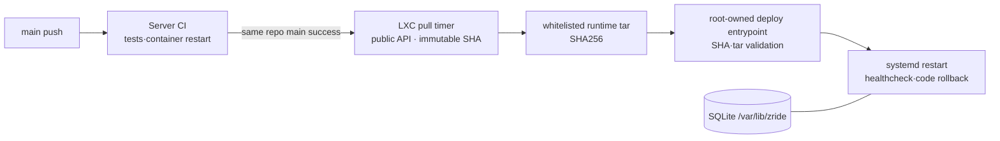

# Proxmox 배포·서버/앱 CI/CD

2026-11-01. 대상은 Proxmox `192.168.0.200`의 별도 비특권 LXC `315`다. 게스트는 Ubuntu 24.04, 현재 DHCP 주소는 `192.168.0.219`다. 게스트 안에서는 **Node 22.13 이상 + systemd + SQLite**로 실행한다. Docker 중첩 권한을 부여하지 않는다. Docker/Compose는 로컬 재현·GitHub CI 경로로 유지한다. 실제 설치·배포 성공 여부는 작업 결과와 Actions 실행 기록으로 확인한다.

## 1. 영속 데이터와 코드 분리

| 위치 | 소유·용도 |
| --- | --- |
| `/srv/zride/releases/<commit SHA>` | root 소유·읽기 전용 배포 코드와 설치한 ws 의존성 |
| `/srv/zride/current` | 현재 릴리스로 향하는 원자적 교체 symlink |
| `/srv/zride/incoming` | `zride-runner`가 검증할 배포 tar를 전달하는 디렉터리 |
| `/var/lib/zride/zride.sqlite` | `zride` 서비스 계정의 영속 DB. WAL/SHM도 같은 디렉터리 |
| `/etc/zride/zride.env` | root 0600. 포트·DB 경로·테스트 접근키·별도 관제 토큰 |
| `/var/backups/zride` | 정지 상태에서 만든 DB/WAL/SHM 백업. root 0700·파일 0600 |
| `/usr/local/sbin/zride-deploy` | root 소유의 고정 배포 진입점. runner가 수정할 수 없음 |

코드 릴리스에 DB·환경 파일·토큰·로그·node_modules를 넣지 않는다. 릴리스마다 `npm ci --omit=dev --ignore-scripts`를 `zride` 계정으로 실행한 뒤 root 소유로 고정한다. SQLite는 단일 프로세스용이며 같은 DB 파일에 여러 서버 인스턴스를 띄우지 않는다. Node 22에서는 `node:sqlite`가 아직 experimental이며 22.13부터 별도 flag가 필요 없다. [Node 22 공식 SQLite 문서](https://nodejs.org/download/release/v22.23.3/docs/api/sqlite.html)

## 2. 서버 CI와 실제 프로세스 재시작 검증

`.github/workflows/server-ci.yml`은 main push·PR·수동 실행에서 다음을 확인한다.

1. 잠금 의존성 설치·서버/계약/DB 테스트.
2. Compose 설정 검사와 실제 이미지 build·기동.
3. 승인된 방·폰 세션·수집 재고 1개·멱등 영수증을 REST로 생성.
4. 컨테이너의 정상 재시작 뒤 같은 세션·roomId·승인·재고 확인.
5. SIGKILL 후 컨테이너를 제거·재생성하되 같은 볼륨 사용.
6. 다시 같은 방·재고 확인, 같은 claim 영수증 재생에도 지급 1회, 차량 허용 gate가 닫혔는지 확인.

시험 자격증명은 runner의 `/tmp`에 mode 0600으로만 쓰고 stdout·artifact에 올리지 않는다. CI 마지막 `down --volumes`는 disposable `zride-ci` 프로젝트만 정리한다. 운영 볼륨에 이 명령을 적용하지 않는다.

로컬 Compose는 아래로 실행한다.

```sh
cd server
docker compose up -d --build
```

기본 노출은 `127.0.0.1:8000`이고, SQLite는 `zride-data` named volume의 `/data`에 남는다. `docker compose restart`·컨테이너 교체는 볼륨을 유지한다. 운영에서 `down --volumes`를 실행하면 영속 데이터도 삭제된다.

## 3. Proxmox 게스트에 한 번 설치할 항목

호스트 관리자는 게스트 안에 서비스 계정 `zride`와 runner 계정 `zride-runner`, Node 22.13 이상, npm, Python 3, curl, tar, util-linux(flock/runuser)를 준비한다. Node 실행 경로는 `/usr/local/bin/node`다. 제공 파일:

- [systemd unit](../deploy/zride.service) → `/etc/systemd/system/zride.service`, root 0644.
- [환경 예제](../deploy/zride.env.example) → `/etc/zride/zride.env`, root 0600. 실제 값은 Git에 넣지 않는다.
- [배포 진입점](../deploy/zride-deploy.sh) → `/usr/local/sbin/zride-deploy`, root 0755.
- [sudoers 예제](../deploy/zride-deploy.sudoers) → `/etc/sudoers.d/zride-deploy`, root 0440. 설치 전 `visudo -cf` 검증.

`/srv/zride/releases`와 `/srv/zride`는 root 소유, `/srv/zride/incoming`만 배포 계정 `zride-runner` 소유로 둔다. `/var/lib/zride`는 서비스 계정 소유 0700이다. 서비스 환경에 `HOST=0.0.0.0`, `PORT=8000`, `ZRIDE_DB_PATH=/var/lib/zride/zride.sqlite`를 설정한다. 외부 테스트에는 `ZRIDE_TEST_ACCESS_KEY`를 반드시 설정한다. 전 방 관제용 `ZRIDE_OBSERVER_TOKEN`과 서로 다른 무작위 값을 만들고 별도로 전달하며 저장소·Actions 출력에 넣지 않는다.

관리자가 기본 파일을 설치하고 `systemctl daemon-reload`, `systemctl enable zride.service`를 실행한다. 첫 릴리스가 설치되기 전에는 `current` 경로가 없으므로 서비스를 시작하지 않는다. 이 문서가 서비스를 이미 설치했다는 실행 증거는 아니다.

## 4. 서버 CD 흐름

공개 저장소에서는 GitHub Actions self-hosted runner를 사용하지 않는다. 기존 runner 서비스와 GitHub 등록을 제거하고, root 소유의 [pull-deploy.py](../deploy/pull-deploy.py)를 전용 비특권 계정으로 실행한다. 이 프로그램이 GitHub 공개 API에서 **같은 리포의 main push·Server CI 성공**만 확인해 해당 SHA의 소스를 가져온다. PR·fork·실패·진행 중 실행은 받지 않는다. main의 더 최근 CI가 실패하면 마지막으로 성공한 main을 유지한다.



관리자가 아래 파일을 root 소유로 설치한다. 배포 계정은 이 파일과 unit을 수정할 수 없어야 한다. `zride-runner`는 계정 이름만 유지하며 Actions runner 프로그램은 실행하지 않는다.

| 소스 | 설치 위치·권한 |
| --- | --- |
| `deploy/pull-deploy.py` | `/usr/local/lib/zride/pull-deploy.py`, root 0755 |
| `deploy/zride-pull.service` | `/etc/systemd/system/zride-pull.service`, root 0644 |
| `deploy/zride-pull.timer` | `/etc/systemd/system/zride-pull.timer`, root 0644 |

`systemctl daemon-reload`, `systemctl enable --now zride-pull.timer`로 켠다. 부팅 90초 후 시작하고 이후 완료 시점부터 180초 간격에 최대 10초 지연을 더한다. `systemctl start zride-pull.service`로 즉시 확인할 수 있다. `systemctl list-timers zride-pull.timer`와 `journalctl -u zride-pull.service`에서 결과를 본다. GitHub 자격증명은 사용하지 않으며 API 제한·네트워크 오류 때는 현재 서비스를 유지한 채 다음 주기에 재시도한다.

GitHub는 공개 저장소의 fork PR이 자체 runner에서 코드를 실행할 수 있으므로 비공개 저장소에만 self-hosted runner를 쓰도록 권고한다. main 조건을 기존 배포 workflow에 넣는 것만으로 다른 PR workflow의 runner 요청까지 제한할 수는 없다. 이 때문에 공개 전 runner를 해제했다. PR 테스트·Android 빌드·릴리스 artifact 생성은 GitHub-hosted runner에서 계속 수행한다. [GitHub runner 접근 정책](https://docs.github.com/en/actions/how-tos/manage-runners/self-hosted-runners/manage-access)

`.github/workflows/server-release.yml`은 hosted runner에서 테스트한 소스 묶음을 artifact로 보관한다. 실제 LXC 배포는 위 poller가 별도로 처리한다. poller는 GitHub API의 고정 workflow 경로·event·branch·head_repository·성공 상태·40자리 SHA를 검사한다. codeload의 해당 SHA에서 런타임 파일만 추출하며 다운로드 16MiB·압축 해제 32MiB·5000개 항목을 넘으면 중단한다. 링크·경로 이탈·필수 파일 누락도 거절한다. 다운받은 checkout의 빌드 스크립트를 실행하지 않고 다음 고정 진입점만 호출한다.

```sh
sudo /usr/local/sbin/zride-deploy <40자리 commit SHA> <64자리 archive SHA256>
```

스크립트가 `/srv/zride/incoming/zride-server-<SHA>.tar.gz`만 읽고 SHA·경로·파일 종류·크기를 검사한다. symlink·hardlink·특수 파일·경로 이탈·중복 파일·DB/환경/로그 파일은 거절한다. `npm ci`는 root가 아닌 서비스 계정으로 scripts 없이 실행한다. 초기 릴리스 staged 후 서비스 정지 → 오프라인 DB 백업 → 코드 symlink 교체 → 재시작 → healthcheck 순서다.

health 실패 시 **코드만** 이전 릴리스로 되돌리고 DB는 유지한다. 새 릴리스가 이미 응답한 수집 결과를 과거 DB로 자동 덮으면 보상을 잃을 수 있기 때문이다. 앞으로 DB 스키마를 바꾸는 릴리스는 호환 migration·백업 복원 절차를 별도로 검증해야 한다. 현재 snapshot format 1의 지속성 구현과 구분한다.

## 5. Android·차량 앱 CI의 범위

`.github/workflows/application-build.yml`은 `android/**` 변경 때 Java 17·Android API34·Build Tools34.0.0과 고정 Gradle wrapper로 차량/폰 APK를 assemble·lint하고, debug APK 두 개와 text/XML lint 보고서를 Actions artifact로 3일 보관한다. Gradle distribution SHA256도 기존 wrapper 설정으로 검증한다. [Android command-line build](https://developer.android.com/build/building-cmdline), [SDK manager](https://developer.android.com/tools/sdkmanager), [GitHub artifacts](https://github.com/actions/upload-artifact)

이것은 **자동 빌드·검증·배포 파일 제공**이다. 실제 사용자의 폰이나 Pleos 차량에 무단으로 APK를 설치하거나 스토어 앱을 조용히 갱신하는 기능이 아니다. 테스트 장치 자동 설치를 추가하려면 앱 팀의 일관된 서명키·versionCode·SDK 호환 정책과, 명시적으로 허용된 ADB serial의 전용 runner가 필요하다. 매번 생성되는 CI debug 키는 기존 설치 앱의 업데이트 서명으로 보장되지 않는다. 프로덕션 앱 배포는 별도 서명·Pleos/스토어 배포·심사 경로를 따른다.

Actions에 올린 APK는 리포 권한이 있는 팀원이 받을 수 있다. Proxmox에 APK를 복사해 내려받게 하는 배포 채널과 실제 기기 설치·업데이트는 서로 다른 작업이며 현재 workflow는 Proxmox APK 파일 서버를 만들지 않는다.

## 6. 관측·운영 한계

- 게스트에서 `systemctl status zride.service`, `journalctl -u zride.service`와 `/healthz`로 확인한다. 자격증명·참가 코드·원시 폰 좌표는 일반 로그에 기록하지 않는다.
- 현재 CT IP는 DHCP라 앱의 고정 접속 주소가 필요하면 DNS 또는 고정 예약을 운영자가 설정한다. runner의 GitHub 연결은 outbound 방식이라 inbound SSH 키를 Actions secret에 넣지 않는다.
- 팀 테스트 주소는 `http://afsd.iptime.org:8000`, 관제 `/observer`, 폰 참가 `/play`, 상태 `/healthz`다. 포트포워딩은 외부 TCP 8000 → LXC `192.168.0.219:8000`이며 Proxmox 관리 포트로 연결하지 않는다. DHCP 주소가 바뀌지 않도록 공유기에서 고정 예약한다.
- 현재 HTTP/WS 테스트 경로에는 세션 생성용 테스트 접근키와 별도 읽기 전용 관제키를 사용한다. HTTP는 암호화되지 않으므로 실제 계정 비밀번호·실제 개인정보를 입력하는 서비스로 사용하지 않는다. 실제 Safari 위치 수집에는 신뢰되는 HTTPS/WSS가 추가로 필요하다. HTTP `/play`는 위치 권한을 요구하지 않는 데모 수집·좌석별 게임 통신을 검증한다. [Geolocation secure context 표준](https://www.w3.org/TR/geolocation/#navigator_interface)
- DB 파일·백업에는 세션의 해시와 방·멤버·획득 기록이 있다. 원시 GPS가 없어도 방문 추론 데이터가 되므로 보존·삭제·접근 통제가 필요하다.
- 자동 백업 보관 정리·외부 백업·모니터링 알림·다중 인스턴스는 아직 별도 운영 과제다. 게스트 재시작 복구는 `systemd enable`과 실제 재부팅 시험으로 확인한다.

Action pins checked 2026-11-01: checkout 7.0.1, setup-node 7.1.0, setup-java 6.1.0, upload-artifact 7.0.2, download-artifact 8.0.2. 모든 workflow는 확인한 full commit SHA를 사용한다.
