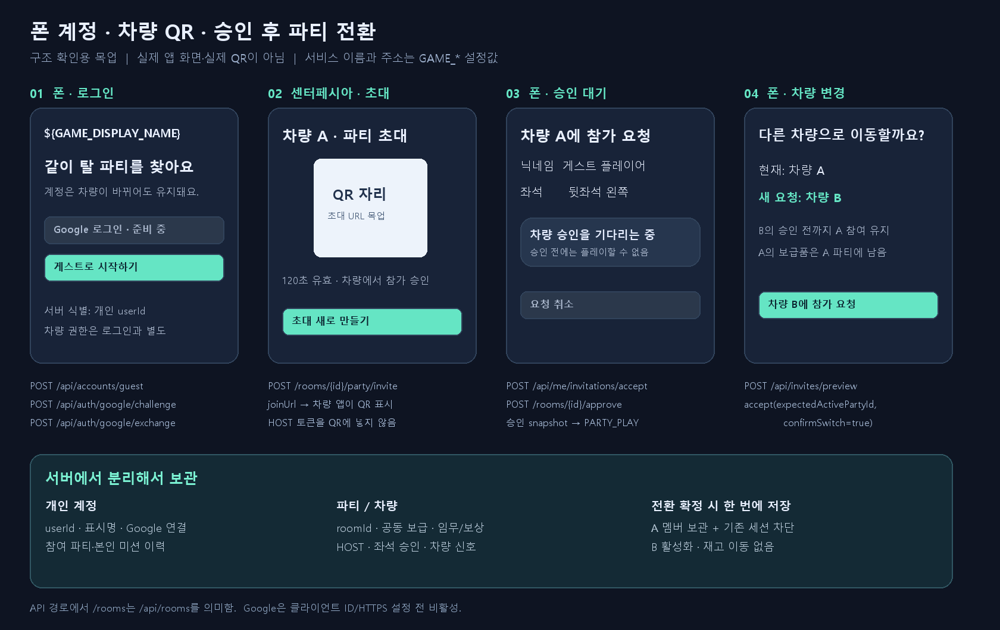
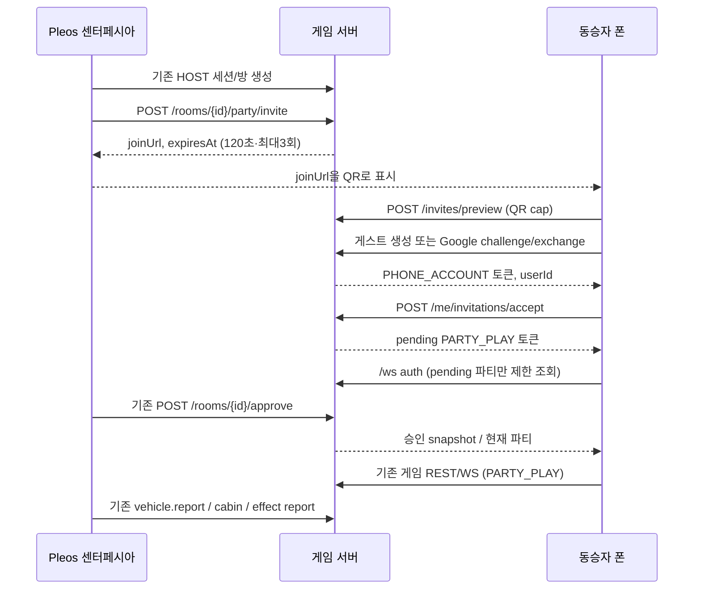
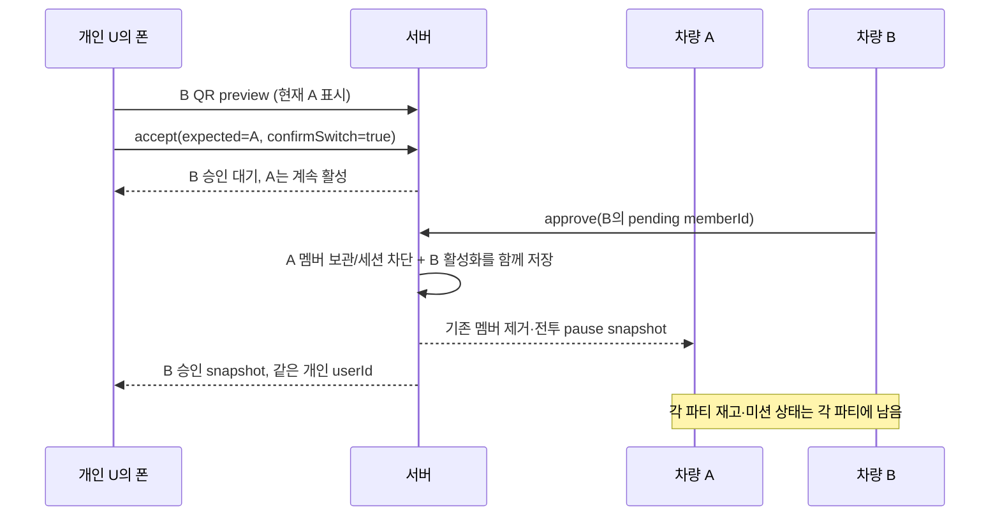

# 폰 계정·차량 QR·파티 전환 통신 — revision 10

2026-11-03 Asia/Seoul. 작업 범위는 **Pleos 센터페시아 앱 ↔ 서버 ↔ 폰**의 계정/참여 API다. 화면은 구조 확인용 목업이며 최종 앱 UI·게임 화면·Google Cloud 등록은 별도다. 전체 REST 55개.

## 폰 웹 참가 페이지 — 2026-11-04

현재 진입점은 **https://hyundai.hjpark.net/play**다. Google 로그인/게스트 시작, 게스트에 Google 연결, QR 미리보기·좌석 참가·차량 변경 동의, 승인 대기/취소, 현재 파티 재연결, 탈퇴·로그아웃을 제공한다. 차량 HOST 앱은 기존 API로 QR을 만들고 참가자를 승인한다. 실제 지도와 차량 SDK 실행은 이 페이지의 범위가 아니다.

Google 클라이언트 ID는 운영 서버 `/etc/zride/zride.env`의 `GAME_GOOGLE_CLIENT_ID`에 넣는다. 브라우저는 `/api/client-config`와 `/api/auth/google/challenge`에서 필요한 공개 설정을 받는다. 승인된 JavaScript 원본은 `https://hyundai.hjpark.net`; 경로 `/play`나 `/api/auth/google/exchange`는 등록하지 않는다. GIS JavaScript popup 콜백의 credential을 기존 서버 nonce와 함께 검증하며, 서버 리디렉션이나 client secret을 사용하지 않는다.

계정 토큰은 API origin별 `sessionStorage`에 보관하고 새로고침 시 refresh로 복원한다. Google ID token과 파티 플레이 토큰은 저장하지 않는다. 게스트는 탭 종료/저장소 삭제 뒤 복구되지 않으며 Google 연결 후 같은 Google 계정으로 복귀할 수 있다. 재연결은 명시적인 버튼으로만 요청하여 다른 기기와 티켓을 무한 교체하지 않는다. 새 참가 요청의 승인 완료만 한 번 자동 연결한다. 4412로 교체된 화면은 자동 재접속하지 않는다. 만료/오류 시 새 게스트를 자동 생성하지 않는다.

Google 버튼은 클릭 후 120초 nonce challenge에 연결해 표시한다. 준비 시간이 지나면 다시 시작해야 한다. CSP는 Google GIS의 script/style/frame/connect 경로만 추가하며 popup용 COOP를 사용한다. QR fragment는 외부 GIS 스크립트를 불러오기 전에 주소에서 제거한다. 기존 코드 참가 버튼은 계정 이력에 연결되지 않는 별도 테스트 모드다.

`phone-account-client.test.mjs`는 브라우저 컨트롤러와 실제 REST 서버를 연결해 게스트→Google 연결의 userId 유지, 탭 복원, QR 제거, 승인 전/후 티켓, 재로그인과 만료 시 비자동 게스트 생성을 검증한다. Google 응답은 합성 fixture이며 실제 사용자 Google 동의/로그인은 사용자의 브라우저에서 확인해야 한다.

## 화면 구조 목업



제품 화면 구현이 아닌 통신 검토용 그림이다. 실제 QR/개인 토큰을 넣지 않았다. 앱은 서버 응답으로 로그인·승인 대기·전환 확인 상태를 표시한다. 설명용 웹사이트는 만들지 않는다.

## 식별자와 데이터 소유권

| 범위 | 데이터 | 차량을 바꾸면 |
| --- | --- | --- |
| 개인 userId | 표시명, Google identity 연결, 방문한 파티 기록, 본인 미션 참여 요약 | 같은 userId로 유지 |
| 파티 roomId | 공동 보급, 미션 진행, 거점 기여/보상 원장, 좌석 승인 | 원래 파티에 남음 |
| 멤버십 membershipId/memberId | 특정 파티에 참가한 기록과 좌석/권한 | 이전 기록 SWITCHED, 새 기록 ACTIVE |
| 차량 HOST 세션 | native 앱 통신·신선한 차량 관측·주차 gate | 폰 로그인으로 발급하지 않음 |
| 개인 계정 토큰 | PHONE_ACCOUNT, /api/me 등 개인 API | 갱신/재로그인 후 이어짐 |
| 파티 플레이 토큰 | PARTY_PLAY, 한 파티의 PHONE REST/WS | 새 승인/재연결 때 별도로 발급 |

예: user U가 차량 A에서 보급 3개를 모은 뒤 B로 이동하면 **userId는 U, A 재고는 3, B 재고는 기존 값**이다. 개인 지갑에 3을 복사하지 않는다. 개인 기록에는 A 활동과 B 활동이 함께 남는다. 전체 파티의 다른 멤버 정보·원시 좌표·차량 제어 권한을 개인 이력 API에 넣지 않는다.

여러 파티에서 활동한 이력을 보유하되 **실제 플레이 참여는 계정당 한 차량 파티만 ACTIVE**로 둔다. 과거 파티로 돌아갈 때도 새 QR·좌석 승인이 필요하다. 여러 기기에서 같은 Google 계정으로 로그인해도 활성 파티는 하나다. 재연결 티켓을 받으면 이전 플레이 세션을 교체하고 전투를 pause한다.

## 센터페시아·폰·서버 호출 순서



도식의 경로는 `/api` 접두사를 생략했다. 차량은 Google 사용자 ID 대신 기존 CAR_HOST 통신 자격증명을 쓴다. 폰 accountToken이나 Google 토큰으로 차량 신호를 보내거나 HOST 권한을 얻을 수 없다. 플레이는 기존 P/UX/foreground/freshness/착석 조건을 계속 검사한다. 차량 승인 UI는 앱의 주행 제한 정책을 지켜야 하며 승인 자체가 게임 실행 허가는 아니다.

QR은 짧은 초대 URL만 담는다. HOST/개인/플레이 토큰을 QR에 넣지 않는다. URL fragment의 invite 값을 폰에서 읽고 주소에서 지운 뒤 POST 본문으로 전송한다. 실제 QR 렌더링·링크 열기 화면은 앱 팀이 구현한다. `GAME_PHONE_JOIN_URL`을 웹 진입/Universal Link 주소로 설정할 수 있으며 서버는 특정 페이지/도메인을 고정하지 않는다.

## 계정·로그인 API

| 경로 | 입력/권한 | 결과 |
| --- | --- | --- |
| GET /api/client-config | 공개 | displayName/API origin/phoneJoinUrl/provider 상태 |
| POST /api/accounts/guest | nickname | userId와 PHONE_ACCOUNT 토큰 |
| POST /api/auth/google/challenge | mode=LOGIN 또는 LINK | challengeId·nonce·clientId, 120초 |
| POST /api/auth/google/exchange | challengeId·credential(ID token) | 계정 토큰/개인 식별자 |
| GET /api/me | 계정 토큰 | 현재 계정·활성/대기 파티 |
| POST /api/me/profile | 계정 토큰, displayName | 표시명 변경 |
| POST /api/accounts/refresh | 계정 토큰 | 같은 계정 토큰의 만료 연장 |
| POST /api/accounts/logout | 계정 토큰 | 현재 계정 토큰 폐기·폰 게임 세션 차단 |

계정 세션은 기본 8시간이다. refresh는 동일 토큰의 만료를 연장하므로 갱신 응답이 유실돼도 기존 토큰을 즉시 잃지 않는다. 만료 전에 갱신하고 동시 갱신 요청은 폰에서 하나로 합친다. 폰의 안전한 저장소에서 관리하고 URL·QR·로그에 넣지 않는다. 서버에는 토큰 해시만 저장한다. 로그아웃과 파티 탈퇴는 별개이며 파티 재고를 삭제하지 않는다.

### Google은 설정 전까지 비활성

2026-11-03에는 Google Cloud 클라이언트가 없어 비활성이었다. 2026-11-04 사용자가 웹 클라이언트 ID를 발급했으며 위 폰 웹 참가 페이지와 HTTPS 운영 설정으로 연결한다. 설정이 없거나 HTTPS가 아니면 provider는 계속 비활성이다. 임의 email/sub를 받아 계정을 만드는 가짜 로그인은 제공하지 않는다.

폰은 서버 nonce를 Google 로그인 요청에 넣고, Google이 서명한 ID token을 credential로 보낸다. 서버는 공식 `google-auth-library` 11.3.2로 서명/발급자/대상/만료를 검증하고 nonce/iat를 추가 검사한다. challenge는 외부 검증 전에 한 번만 사용했다고 저장하므로 경쟁 요청·재시작으로 재사용하지 못한다. Google access/refresh token과 원본 ID token은 DB에 보관하지 않는다.

Google identity는 발급자+sub를 해시한 키로 연결하고 이메일로 계정을 합치지 않는다. 웹 GIS는 nonce를 지원한다. 폰 팀이 native SDK를 선택할 경우에도 서버 nonce를 지원하는 ID-token 흐름인지 확인해야 하며, 지원하지 않는 SDK에는 별도 OIDC 어댑터 검토가 필요하다. 이 문서가 실제 iPhone/Android Google SDK 연동 완료를 뜻하지 않는다.

- LOGIN: 기존 Google identity가 있으면 같은 userId로 복귀한다. 없으면 새 개인 계정을 만든다.
- LINK: 현재 게스트 계정 토큰으로 challenge를 만들고 교환한다. **기존 게스트 userId·멤버십·이력 유지** 후 Google 계정으로 연결한다. 이전 게스트 계정 토큰은 폐기한다.
- 다른 계정에 이미 연결된 Google identity이면 ACCOUNT_LINK_CONFLICT. 자동 병합/재고 복사하지 않는다. 앱은 기존 게스트 토큰/참여 상태를 덮어쓰지 말고 기존 계정 로그인 또는 게스트 계속 사용을 명시적으로 선택하게 한다.
- 게스트 토큰을 잃거나 브라우저 저장소를 지우면 같은 게스트를 다른 기기에서 복구할 수 없다. 장기 복귀는 Google 연결 후 지원한다.

클라이언트가 준비되면 실제 사이트의 Google Authorized JavaScript Origin/client ID를 등록하고 GAME_GOOGLE_CLIENT_ID를 설정한다. 이 로그인 검증 방식에는 Google client secret을 폰이나 서버 API 본문에 넣지 않는다. 사용자가 Cloud 클라이언트를 생성했으며 실제 사용자 동의/기기 로그인은 별도로 확인한다.

근거: [Google ID token 서버 검증](https://developers.google.com/identity/gsi/web/guides/verify-google-id-token), [GIS nonce](https://developers.google.com/identity/gsi/web/reference/html-reference#data-nonce), [OIDC](https://developers.google.com/identity/openid-connect/openid-connect). Pleos의 차량 소유자 OAuth는 이 폰 로그인과 다른 목적이며 기존 비활성 포트로 유지한다.

## QR 참가·차량 변경 API

| 경로 | 역할 |
| --- | --- |
| POST /api/invites/preview | 초대 유효성·대상 파티명·좌석·승인 필요 여부. 계정 토큰이 있으면 현재 파티와 변경 필요 표시 |
| POST /api/me/invitations/accept | 계정 토큰으로 pending PHONE 참가 |
| POST /api/me/invitations/cancel | 새 차량 승인 대기 취소. 이전 활성 파티 유지 |
| POST /api/me/party-ticket | 현재 승인 파티의 새 플레이 세션 발급. 이전 세션 교체 |
| POST /api/me/party/leave | 현재 파티에서 탈퇴 |
| GET /api/me/parties | 본인 멤버십 이력/상태 |
| GET /api/me/history | 본인이 참가한 미션의 개인 요약. 기본50/최대100, offset/nextOffset |

```json
{
  "inviteToken":"QR fragment의 초대 값",
  "seat":"REAR_LEFT",
  "passengerConfirmed":true,
  "expectedActivePartyId":null
}
```

이미 A에 있다면 expectedActivePartyId에 A의 ID와 confirmSwitch=true를 보낸다. 확인 값이 없거나 오래된 파티이면 QR 사용/이전 참여를 바꾸기 전에 409로 거부한다.



새 승인이 실패/취소/거절되면 이전 파티를 유지한다. 변경 동의는 5분 유효이며 승인 시 현재 활성 멤버십이 그때의 값과 일치해야 한다. 중간에 다른 기기가 전환하거나 탈퇴했다면 PARTY_SWITCH_CONFLICT로 거부하고 다시 확인한다.

동일 파티 QR이면 ALREADY_IN_PARTY를 반환하므로 party-ticket으로 재연결한다. 참가 응답이 유실돼 PENDING_JOIN_EXISTS가 나오면 새 게스트를 만들지 말고 /api/me의 대기 상태를 복구한다. 승인 뒤 party-ticket으로 플레이 자격증명을 다시 받는다. Google 교환 응답을 잃으면 새 LOGIN challenge로 재시도해 같은 identity로 복귀한다.

새로운 ticket은 sessionId/memberId/room/token을 제공하며 이전 플레이 토큰·연결을 교체한다. **계정 토큰을 /ws에 직접 보내지 않는다.** 새 승인/이전 파티 제거·계정 참여 변경은 같은 checkpoint로 저장하고 저장 실패 시 성공 응답/전환 방송 없이 503으로 차단한다.

이전 방식 `/api/invites/redeem`·참가 코드 기반 익명 세션은 참조 앱 호환용으로 남겼다. 이 경로로 만든 기존 익명 플레이 기록을 새 개인 계정의 소유라고 추정해 가져오지 않는다. 개인 이력이 필요한 신규 폰 구현은 반드시 계정 생성/로그인 후 `/api/me/invitations/accept`를 사용한다.

## 연결 복구 시 앱 처리

- ACCOUNT_AUTH_REQUIRED에서 자동으로 새 게스트를 만들지 않는다. 기존 계정 재로그인/토큰 보관 상태를 확인한다.
- PENDING_JOIN_EXISTS는 /api/me의 대기 참가를 복구하고 승인 후 party-ticket을 받는다.
- PARTY_SWITCH_CONFLICT/SWITCH_CONFIRMATION_EXPIRED는 새 현재 파티를 확인하고 필요하면 대기를 취소한 뒤 전환을 다시 확인한다.
- WS 4412는 다른 기기의 계정 재연결로 게임 세션이 교체된 것이다. 자동으로 ticket을 계속 재발급하면 두 기기가 서로 밀어낼 수 있으므로 명시적 사용자 재연결을 기다린다.
- WS 4410에서는 /api/me로 활성/대기 파티를 다시 확인한다. 4413은 계정 로그아웃이다.
- 계정에 연결된 플레이 토큰으로 옛 /api/join을 호출하면 ACCOUNT_PARTY_JOIN_REQUIRED다. 새 참가·전환은 계정 API를 사용한다.

## 이름과 주소 설정

| 일반 설정 | 용도 |
| --- | --- |
| GAME_DISPLAY_NAME | 화면/클라이언트 설정에 표시할 서비스 이름 |
| GAME_PUBLIC_ORIGIN | 신뢰할 API 공개 origin |
| GAME_PHONE_JOIN_URL | QR이 열 웹/앱 링크 주소 |
| GAME_BROWSER_API_ORIGIN | 참조 폰 클라이언트의 API/WS 목적지 |
| GAME_GOOGLE_CLIENT_ID | Google 웹/서버 ID token audience |
| GAME_ALLOWED_ORIGINS | 폰 HTTP/WS 허용 origin |
| GAME_OBSERVER_ALLOWED_ORIGINS | 읽기 관제의 별도 origin |
| GAME_TRUSTED_PROXY_ADDRESSES | 직접 TLS 프록시 peer의 정확한 IP |
| GAME_DB_PATH / GAME_PLACES_PATH | DB/장소 파일 |
| GAME_TEST_ACCESS_KEY / GAME_OBSERVER_TOKEN / GAME_PLACE_REVIEW_TOKEN | 기존 배포 키의 일반 이름 별칭 |

이름/주소 변경은 userId/partyId/membershipId/DB identity와 연결하지 않는다. 기존 ZRIDE_* 설정은 호환 별칭으로 유지하며 GAME_*가 있으면 우선한다. 내부 프로토콜/서비스 호환 식별자를 화면 이름 때문에 바꾸지 않는다. DNS/Cloudflare 설정은 이번 작업에서 변경하지 않는다.

PUBLIC_ORIGIN이 HTTPS이면 계정 API는 실제 TLS 또는 명시적으로 신뢰한 프록시의 X-Forwarded-Proto=https를 요구한다. 임의 클라이언트의 위조 forwarded 헤더는 인정하지 않는다. HTTPS 운영 주소는 hyundai.hjpark.net이며 프록시 peer와 허용 origin을 함께 설정한다. 이 전환 뒤 기존 HTTP 직접 주소의 계정 API는 AUTH_HTTPS_REQUIRED로 차단한다.

## 저장 이행과 남은 범위

새 개인 계정이 다운그레이드 코드에 의해 조용히 삭제되지 않도록 checkpoint를 **format 2**로 올렸다. 현재 코드는 기존 format1을 자동 이행하며 기존 재고/방/결과를 유지한다. format1 전용 이전 코드는 format2를 거부한다. 배포기는 변경 전 비공개 DB 백업을 만들고, 다운그레이드하려면 관리자가 그 백업 복원 여부를 결정해야 한다. 자동 코드 롤백만으로 format2를 예전 코드로 열 수 없다.

정식 개인정보 고지·계정 삭제·사용자 간 명시적 계정 병합·개인 지갑·부정 다중 계정 방지는 후속이다. 현재 기록은 자동 삭제하지 않는다. 게스트/Google ID가 실제 서로 다른 사람/탑승자라는 증명은 아니며 운전자 배제는 앱 안내와 기존 차량 안전 조건을 계속 지켜야 한다.

## 검증/재현

- accounts.test: 공식 라이브러리로 합성 RSA 서명 ID token 검증, issuer/audience/nonce/만료, 동일 sub 복귀, 같은 이메일의 다른 sub 분리, 연결 충돌, 기존 게스트 토큰 폐기.
- account-integration.test: 실제 REST/WS+SQLite, 두 차량 간 승인 전/후 전환, 전환 저장 실패→복원, 재고 비이동, 개인 미션 이력, 토큰 용도 격리, 재시작·재연결·취소·로그아웃, HTTPS 프록시, 중복 Google challenge 교환, format1→2·이름 변경 후 userId 유지.
- Google Cloud 클라이언트는 사용자가 생성했다. 실제 사용자 Google 동의/실물 폰 로그인은 아직 검증하지 않았으며 서명/서버 통신은 합성 자격증명으로 검증한다.

```sh
node tools/account-flow-demo.mjs http://127.0.0.1:8000
```

이 API 전용 목업은 가상 차량 A/B와 테스트 폰을 만들고 QR→승인→차량 전환을 실행한 뒤 정리한다. 보호된 배포는 접근키를 ZRIDE_TEST_ACCESS_KEY 또는 GAME_TEST_ACCESS_KEY 환경으로만 전달한다. 토큰·초대 값은 출력하지 않는다. 로그에 표시하는 단계/경로로 앱 담당자가 통신 구조를 확인할 수 있다.
