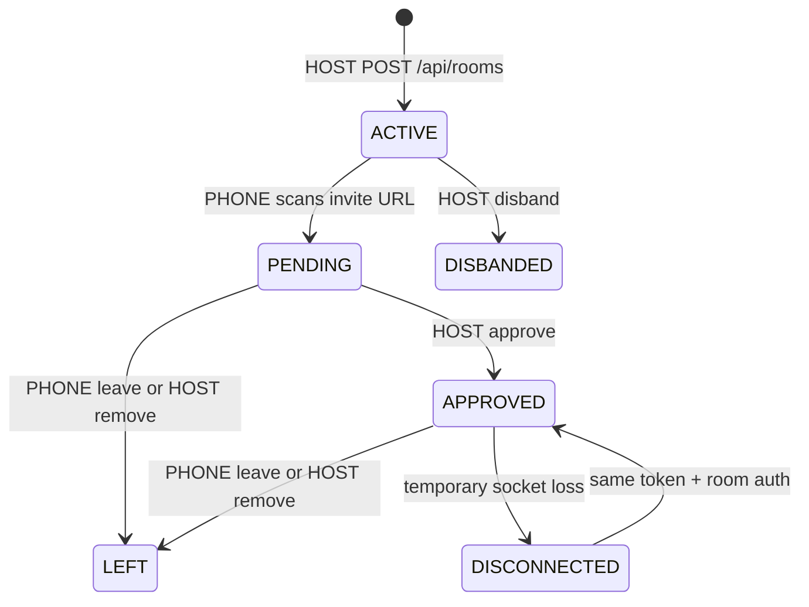

# 장소·경로·파티 연동 — revision 7

2026-11-02 (Asia/Seoul). 서버·폰 참조 클라이언트의 실행 계약이다. 차량 앱의 QR 이미지 렌더링·NaviHelper 어댑터·최종 지도 UI는 앱 팀이 이 API에 연결한다.

## 설치와 원본

```sh
node tools/import-places.mjs /var/lib/zride/places.json --with-demo
```

고정된 [길벗 manifest](https://gilbeot-map-workshop.woojin-jang05.chatgpt.site/data/manifest.json)의 22개 shard를 SHA256·바이트 수·행 수·좌표·ID 중복 검사 후 임시 파일→rename으로 교체한다. 버전은 manifest 해시다. 106,361개 원본은 별도 데이터 파일에 두며 런타임 코드 archive/공개 Git 이력에 복사하지 않는다. `--with-demo`는 실제 주차장이 아닌 DEMO_PARKING_SPOT 1개를 추가한다. metadata source·ODbL-1.0·attribution·snapshotAt을 보존한다. 주유소 타입 FUEL_STATION은 지원하지만 현재 upstream에는 주유소 원본이 없어 0개다.

환경 변수:

| 값 | 용도 |
| --- | --- |
| ZRIDE_PLACES_PATH | import된 JSON 경로. 미설정이면 빈 원본 catalog로 기존 테스트 world 유지 |
| ZRIDE_PLACE_REVIEW_TOKEN | 검수 쓰기 전용 비밀키. 운영자 observer 읽기 키와 별도 |
| ZRIDE_PUBLIC_ORIGIN | 신뢰하는 HTTP(S) origin. QR 링크는 요청 Host 헤더를 사용하지 않음 |

원본 갱신 뒤 서버 재시작이 필요하다. 원본에 포함된 명소를 검수 완료로 승격하지 않는다. 대량 catalog는 읽기 전용이며 SQLite에는 검수·파티 설정·거점 기여만 저장한다. 파일 누락/잘못된 catalog는 시작 실패로 처리한다.

## 차량 접근성과 경로

- GET `/api/places/catalog`: 데이터 버전·개수·worldRevision·출처.
- POST `/api/places/nearby`: 승인 멤버. latitude/longitude, radiusM 1~10000, limit 1~100, category 선택. 기본 eligibleOnly=true; false이면 미검수 후보도 검토할 수 있다. 방문/보상 판정이 아니다.
- POST `/api/admin/places/review`: 별도 reviewer Bearer. VERIFIED+enabled에 입구·게임 구역·주차/체류 허용·검수 근거가 필요하다. 일반 HOST/PHONE/observer 키로 승인할 수 없다.
- POST `/api/rooms/{roomId}/route`: HOST. commandId, expectedRouteRevision, source, geometry. source=PLEOS_ROUTE/EXTERNAL_ROUTING/DEMO_ROUTE. source=NONE으로 취소한다.
- GET `/api/rooms/{roomId}/route`: 승인 멤버에게 geometry 없는 현재 revision·만료·source·길이 요약.
- POST `/api/rooms/{roomId}/route/spots`: 승인 멤버. 최신 routeRevision, corridorM 10~2000. 검수된 입구 좌표 기준 경로 선분 거리를 계산한다. 결과는 최대 100개, dataVersion·worldRevision·policyVersion을 포함한다.

```json
{"commandId":"route-1","expectedRouteRevision":0,"source":"DEMO_ROUTE","geometry":[{"latitude":37.56,"longitude":126.978},{"latitude":37.57,"longitude":126.978}]}
```

경로는 2~128개 점, 선분 최대 20km, 총 길이 1m~500km, 30분 TTL이다. 16KiB 본문 상한을 유지한다. 경로 geometry·QR 토큰은 SQLite에 저장하지 않으며 재시작하면 경로를 다시 제출한다. routeRevision은 전투 roomEpoch와 별개다. 원시 경로는 로그·공개 파티·snapshot으로 방송하지 않는다. 거리 계산은 짧은 선분에 대한 지역 평면 근사이며 극지/날짜변경선 경로용 기능이 아니다.

후보의 accessStatus=VERIFIED는 사람의 검수 기록이다. **도로망 우회 계산은 아직 없으며** detourTimeSec=null, roadAccess=DETOUR_UNKNOWN으로 반환한다. 반대 차도·중앙분리대 접근을 서버가 독립 인증했다고 표시하지 않는다. 미검수·비활성·주차/체류 미허용 장소는 경로 결과에서 제외한다. 보행 명소를 도로 최근접만으로 자동 활성화하지 않는다.

NaviHelper geometry 수신 여부는 별도 AVD 검증 항목이다. DEMO_ROUTE는 실제 내비 경로가 아니며, 외부 라우팅 경로도 PLEOS_ROUTE로 위장하지 않는다.

## 파티 생성·참가·탈퇴·해산



roomId=partyId다. 위 파티 lifecycle은 전투의 LOBBY/READY/PLAYING/PAUSED/CLEARED와 별도다.

1. HOST는 기존 접근키로 세션/방 생성. POST `…/party/invite`로 120초·최대 3회 사용 QR URL을 받는다. 차량 앱은 joinUrl을 로컬 QR 라이브러리로 렌더한다. 서버가 이미지를 외부 QR 서비스로 보내지 않는다.
2. `/play#invite=…`를 폰 기본 브라우저에서 열면 fragment를 즉시 주소에서 지우고 메모리에 보관한다. 닉네임·좌석·동승자 확인만 받아 POST `/api/invites/redeem`으로 pending PHONE 세션을 발급한다. 설치·Google 로그인·팀 접근키 없이 가능하다. URL 보유만으로 HOST나 승인 권한을 얻지 않는다.
3. HOST가 기존 approve API로 좌석을 확인한다. 승인 전에는 전체 게임·경로·공유 API를 사용할 수 없다.
4. POST `…/party/leave`: PHONE 자신. pending도 취소 가능. 좌석·소켓·방 멤버십을 해제하고 전투를 pause한다. 클라이언트의 새로고침·소켓 종료 자체는 탈퇴가 아니며 연결 복구를 허용한다.
5. POST `…/party/remove`: HOST가 PHONE memberId 제거/거절. 전투 pause. HOST 자신은 이 경로로 제거할 수 없다.
6. POST `…/party/disband`: HOST만 가능. 공유·경로·QR·기존 코드·모든 게임 소켓을 닫고 기존 partyId로 재개하지 않는다. HOST는 새 방을 만들 수 있다. 일시 연결 끊김/폰 0명은 자동 해산이 아니다. 리더 자동 승계는 없다.

탈퇴자의 기존 지급/기여 기록은 보존한다. 기존 세션으로 같은 방에 기존 참가 코드로 재참가하면 같은 memberId/영수증을 재사용하며 재승인이 필요하다. QR 재참가는 새 게스트 신원이다. 계정 없는 게스트는 개인의 장기 인벤토리·기기 간 복구·실명/운전자 인증을 제공하지 않는다. 방 인벤토리는 탈퇴 시 개인에게 분배하지 않는다.

QR 교체·해산·서버 재시작 때 과거 QR은 무효다. inviteToken과 게임 token은 URL query·Git·로그·일반 snapshot에 저장하지 않는다. QR은 짧은 기간의 참가 권한이므로 차량 화면에서만 공유한다. 현재 HTTP 배포는 암호화되지 않으므로 Google 로그인/실제 위치의 외부 서비스 배포에는 HTTPS가 필요하다.

## 파티 간 거점 공유

- HOST POST `…/party`: commandId, visible, name, spotId(검수 승인된 스팟 또는 null). 기본 공개 안 함.
- 승인 멤버 GET `/api/spots/{spotId}/shared`: 그 스팟의 공개 파티 요약·공동 인스턴스. 파티 요약에는 partyId·공개 이름·승인 인원·전투 phase만 있다. 최근 연결/보고 없는 파티는 목록에서 제외한다.
- 승인 게임 소켓에서 `{type:"world.subscribe",commandId,spotId}` → `world.snapshot`. 변경 시 spot 단위 최신 snapshot을 보낸다. 한 소켓은 스팟 하나 구독. world.unsubscribe로 해제한다. 전체 방 snapshot·원시 경로/GPS·cabin·역할 nonce·참가 코드는 공유하지 않는다. 재연결 시 재구독하며 최신 worldRevision을 읽는다. 이벤트 재생/전역 채팅/모든 주변 파티 검색은 이번 구현 범위가 아니다.
- HOST POST `…/party/contribute`: commandId, spotId, expectedInstanceRevision. 공개 선택 스팟·신선한 주차 gate·서버가 판정한 방어 클리어/임무 완료가 필요하다. 한 partyId가 인스턴스당 1회 기여. 세 파티 기여로 완료한다.

동시 기여는 instance revision으로 검사한다. 같은 명령은 같은 결과를 재전송하며 변경 본문은 충돌이다. 완료된 라운드 하나는 한 스팟에만 기여할 수 있으며 같은 클리어를 스팟 변경으로 반복 제출할 수 없다. receipts/기여/검수 상태를 SQLite 커밋한 뒤 ACK/공유 snapshot을 보낸다. **위치 방문 증명·경제 보상 지급은 하지 않는다(rewardGranted=false).** 현 단계의 인스턴스는 스팟당 지속되는 1개이며 시즌 리셋/다중 인스턴스 정책은 추후 추가한다.

## 인증 연동 준비

GET `/api/auth/providers`는 게스트 초대 사용 가능, Google/Pleos 로그인 비활성을 반환한다. `auth-providers.mjs`는 추후 실제 Google verifier를 주입할 수 있는 서버 내부 포트다. 일반 HTTP 요청에서 임의 provider/subject/email로 계정을 등록하는 API는 없다.

Google 연동 후 구현할 항목: HTTPS origin·Google Cloud client ID, 로그인 nonce/CSRF 발급·검사, 공식 라이브러리의 ID token 서명·iss·aud·exp 검증, sub 기반 계정 키, 기존 게스트의 명시적 계정 연결과 중복 병합 정책, 로그아웃·계정 복구. 현재 구조만 준비했으며 Google 로그인으로 게임 기록이 저장된다고 표시하지 않는다.

Pleos에는 **Vehicle Data API의 OAuth 2.0 차량 소유자 인증·데이터 제공 동의**가 있다. 사업자 API에는 제조사 로그인·redirectUrl/state 및 API 신청 승인이 필요하며, 공식 소개 문서는 현재 제공 지역을 유럽으로 안내한다. 이것을 모든 동승자의 일반 게임 소셜 로그인으로 가정하지 않는다. 한국 AVD 데모에는 이 API를 연결하지 않고 비활성 차량 소유자 인증 확장 지점으로 표시한다.

[Google 검증 가이드](https://developers.google.com/identity/gsi/web/guides/verify-google-id-token) · [Google HTTPS 정책](https://developers.google.com/identity/protocols/oauth2/policies) · [Pleos NaviHelper 변경사항](https://document.pleos.ai/docs/pleos-only/release-note/sdk-261015)

[Pleos Vehicle Data API·지원 지역](https://document.pleos.ai/en/api-reference/vehicle-data-api/intro) · [차량 소유자 로그인](https://document.pleos.ai/en/api-reference/vehicle-data-api/vehicle-data-api/for-business-users/login-api) · [사업자 인증](https://document.pleos.ai/en/api-reference/vehicle-data-api/getting-started/for-business-users/authorization)
