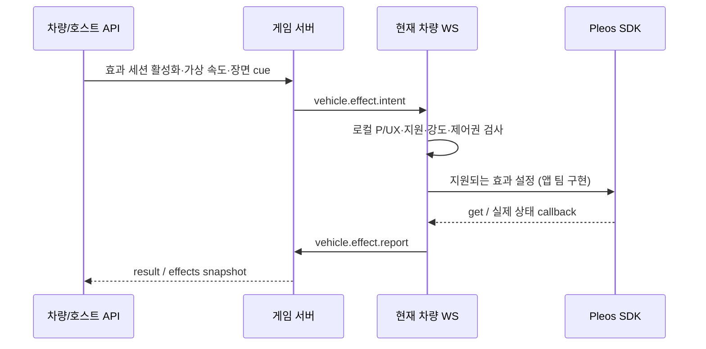

# 4D 차량 효과 API — revision 6

2026-11-01 (Asia/Seoul). 서버가 게임의 가상 속도·위험 이벤트를 **의미 있는 효과 의도**로 보내고, 차량 앱이 지원되는 공조·조명·음향으로 바꾸는 통신 계약이다. 물리 SDK 실행은 차량 앱의 역할이다. 현재 Android 참조 앱에는 이 효과 수신·실제 setter 실행기가 없다. 이 API의 성공을 실제 바람·조명 변화나 공조 원복의 증거로 해석하지 않는다.

게임 속 가상 속도는 실제 도로 주행속도와 다르다. 효과 의도를 발행하려면 호스트의 현재 게임 소켓, PLAYING 상태, 신선한 차량 보고, P·UX ALLOWED·foreground=true가 모두 필요하다. 현재 CAR_HOST는 공유 테스트 키를 통한 데모 역할이며 실제 차량 자격을 독립 인증하지 않는다.

## 통신과 권한



| 경로·메시지 | 호출자 | 책임 |
| --- | --- | --- |
| GET `/api/rooms/{roomId}/effects` | 승인된 해당 방 멤버 | 현재 4D 상태 조회. 물리 효과 실행용 채널이 아님 |
| POST `…/effects/session` | 해당 방 CAR_HOST | 현재 차량 연결이 명시적으로 활성화한 지원 채널·강도 상한 설정 |
| POST `…/effects/scene` | 해당 방 CAR_HOST | 가상 장면·속도를 설정하고 AIRFLOW 바람 의도 발행 |
| POST `…/effects/cue` | 해당 방 CAR_HOST | DANGER·HIT·ESCAPE를 지원 채널의 효과 의도로 변환 |
| POST `…/effects/stop` | 해당 방 CAR_HOST | 효과 세션 전체 중지·무효화 |
| WS `vehicle.effect.report` | **현재 인증된 CAR_HOST 소켓** | 수신·설정 호출·실제 반영·실패·중단 결과 보고 |

REST에는 기존 `Authorization: Bearer <호스트/멤버 토큰>`을 사용한다. POST 네 경로에는 매번 `commandId`가 필요하다. PHONE·관제는 효과를 발행하거나 차량의 실행 결과를 보고할 수 없다. 승인 대기 PHONE은 효과 조회도 거부된다. HTTP report 경로는 없으며 실제 차량 소켓으로 보고한다.

현재 외부 base는 `http://afsd.iptime.org:8000`, 개발 PC는 `http://127.0.0.1:8000`이다. HTTP 테스트 주소는 암호화되지 않는다. 토큰·접근키·참가 코드를 URL·Git·노션·일반 로그에 넣지 않는다.

## 먼저 기존 방의 공동 전투 시작

기존 세션·방·참가 승인·차량 보고 계약을 먼저 따른다. 현재 차량 소켓에서 `vehicle.report`를 보내고 승인된 연결 폰이 있는 상태에서 `round.start`를 실행한다. 기본 차량 보고 간격은 2초, lease는 6초다. 효과 세션은 활성 공동 전투에 묶인다.

CAR_HOST의 WS `auth.ok`에는 자기 현재 연결의 `vehicleConnectionId`가 추가된다. PHONE의 auth.ok·게임/관제 snapshot에는 이 연결 바인딩 값을 넣지 않는다. 새 차량 소켓에서는 값이 바뀐다. 이 값은 Bearer 토큰을 대신하지 않는다.

네이티브 앱의 사용자 활성화와 capability 확인 결과를 반영해 다음 요청을 보낸다. 먼저 GET effects에서 최신 `controlVersion`을 읽는다(새 방의 초기값 0). `vehicleConnectionId`는 현재 차량 auth.ok의 값, `expectedControlVersion`은 방금 조회한 버전을 그대로 넣는다. `locallyEnabled:true`는 클라이언트의 명시적 활성화 주장이지 차량 인증이나 실제 권한 획득 증명이 아니다.

```json
{
  "commandId": "fx-session-001",
  "enabled": true,
  "vehicleConnectionId": "<현재 CAR_HOST auth.ok의 연결 ID>",
  "expectedControlVersion": 0,
  "locallyEnabled": true,
  "channels": ["AIRFLOW", "AMBIENT", "AUDIO"],
  "maxIntensity01": 0.6
}
```

`POST …/effects/session` 성공 시 새 `effectSessionId`를 만든다. `channels`는 실제 차량 앱이 지원·허용한 채널만 선언한다. 서버가 SDK capability를 직접 읽지는 않는다. intensity는 0~1의 논리 강도이며 물리 풍속·팬 단계·색상 코드가 아니다.

## 가상 속도 → 바람

`heist-demo-v1`에서는 활성 4D 세션의 장면·속도를 서버 게임 상태에서 자동 갱신한다. 수동 `/effects/scene` 요청은 409 `GAME_SCENE_MANAGED`로 거부하며 게임의 `/game/input`으로 가속·제동 입력을 보낸다. 기본 `generic-coop-v1`의 수동 시연은 아래 API를 사용한다. [임무·가상 이동 계약](server-state.md)

`POST …/effects/scene`:

```json
{"commandId":"fx-scene-001","effectSessionId":"<활성화 응답의 효과 세션>","sceneId":"escape-01","virtualSpeedMps":18}
```

속도 단위는 m/s, 허용 범위는 0~100이다. AIRFLOW 채널이 활성화돼 있으면 `DRIVE_WIND` 의도를 만든다.

```text
intensity01 = min(virtualSpeedMps / 30, 1) × maxIntensity01
```

예시의 18m/s와 상한 0.6이면 강도는 0.36이다. 이 값은 차량 앱이 capability의 실제 범위와 사용자가 허용한 상한으로 변환한다. 강도 0을 차량 공조 OFF 명령으로 해석하지 않는다. 물리 설정값은 차량 앱의 로컬 정책이다.

## 위험·피격·탈출 cue

`POST …/effects/cue`:

```json
{"commandId":"fx-cue-001","effectSessionId":"<활성화 응답의 효과 세션>","sceneId":"escape-01","cue":"DANGER","intensity01":0.8,"durationMs":3000}
```

cue는 `DANGER / HIT / ESCAPE`다. 현재 세션 상한 안으로 강도를 제한하고 지원된 AMBIENT/AUDIO 채널에 의미 있는 의도를 보낸다. 지속시간은 정수 100~5000ms, 생략/null 시 3000ms다. scene·cue에는 현재 `effectSessionId`가 필수이며 새 세션에 과거 요청을 자동 바인딩하지 않는다. 먼저 scene을 설정해야 하고 cue의 sceneId는 현재 장면과 같아야 한다. sceneId는 1~64자의 영문·숫자·점·콜론·밑줄·하이픈이다. 지원하지 않는 채널을 서버 응답 성공만으로 실제 하드웨어가 실행됐다고 표시하지 않는다. 기본 음향·공통 조명과 개별 좌석 스피커/조명은 별도 기능이다.

## 차량만 받는 실행 의도

서버는 현재 차량 게임 WebSocket에 다음 형태를 보낸다. 아래 시간값·ID는 예시다.

```json
{
  "type": "vehicle.effect.intent",
  "schemaVersion": 1,
  "roomId": "<현재 방 ID>",
  "roomEpoch": 3,
  "effectSessionId": "<현재 효과 세션>",
  "effectId": "<고유 효과 ID>",
  "effectSeq": 1,
  "sceneId": "escape-01",
  "channel": "AIRFLOW",
  "cue": "DRIVE_WIND",
  "intensity01": 0.36,
  "transitionMs": 500,
  "issuedAt": 1793500000000,
  "expiresAt": 1793500003000
}
```

**실행 채널은 새로운 WS `vehicle.effect.intent`뿐이다.** HTTP `data.intents`, GET 상태, 게임/관제 snapshot의 `active` 배열, 멱등 재전송 응답은 실행용으로 사용하지 않는다. 재시도 응답에 과거 의도 정보가 들어 있어도 물리 효과를 다시 실행하면 안 된다.

차량 앱은 현재 방·epoch·effectSessionId·sceneId·순서·만료를 확인하고 중복 effectId를 실행하지 않는다. 시간·강도·transition은 서버의 의미 있는 목표이며 SDK의 처리 지연·부드러운 전환 보장이 아니다. 프레임마다 setter를 호출하지 않고 목표 병합·최소 변경 간격·사용자 조작 우선을 로컬에서 구현해야 한다.

## 실제 반영 결과 보고

같은 현재 차량 소켓에서 보낸다. commandId는 이 보고 요청의 새 ID이며 effectId/effectSeq는 받은 의도와 일치해야 한다.

```json
{
  "type": "vehicle.effect.report",
  "commandId": "fx-report-001",
  "effectSessionId": "<받은 효과 세션>",
  "effectId": "<받은 효과 ID>",
  "effectSeq": 1,
  "status": "APPLIED_CONFIRMED",
  "observedValue": 5
}
```

| 상태 | 의미 |
| --- | --- |
| RECEIVED | 차량 앱이 의도를 받음 |
| DISPATCHED | 차량 앱이 SDK 설정 호출을 시도함 |
| APPLIED_CONFIRMED | 차량 앱이 get/상태 callback으로 반영을 확인했다고 보고함 |
| UNSUPPORTED | 해당 채널·영역을 지원하지 않음 |
| REJECTED_GATE | 차량 로컬 조건이 실행을 허용하지 않음 |
| USER_OVERRIDDEN | 사용자가 제어권을 가져감 |
| FAILED | SDK 실행·확인 실패 |
| STOPPED | 효과 중지 |

observedValue는 선택적인 유한한 숫자·boolean·null이며 문자열·임의 객체·SDK 전체 진단 덤프는 거부한다. APPLIED_CONFIRMED에는 null이 아닌 관측값이 필수다. 만료·중지·과거 세션·다른 효과 순서의 보고는 거부하고, 이미 끝난 상태를 수신 단계로 되돌리지 않는다. APPLIED_CONFIRMED는 **차량 클라이언트의 관측 주장**이며 서버의 하드웨어 독립 인증이 아니다. SDK setter마다 성공 ACK가 있다고 가정하지 않는다.

## 조회·중지·재시도

GET 효과 응답은 `{effects}`이며 POST 응답은 `{effects,data,replayed}`다. effects는 현재 상태, data는 해당 명령의 논리 결과다. snapshot에는 활성 여부·controlVersion·장면·가상 속도·채널·상한·최근 실행 보고·중지 사유가 들어간다. 승인된 폰은 게임 HUD에 이를 표시하고, 관제는 별도 읽기 전용 projection을 사용한다.

중지:

```json
{"commandId":"fx-stop-001"}
```

또는 session에 `{commandId,enabled:false}`를 보낸다. 활성 효과를 중단하는 요청은 주차 전투 gate가 닫힌 상태에서도 가능하다. 다시 켜려면 새 조건 확인과 명시적 session 활성화가 필요하다.

같은 commandId·같은 본문 재요청은 논리 결과를 재사용하지만 **WS 의도를 다시 내보내지 않는다**. 본문을 바꾼 같은 ID는 충돌이다. 효과 멱등 정보는 현재 연결/전투 범위의 메모리이며 기존 게임 명령·획득 영수증과 구분한다. 세션·연결·전투가 바뀌면 과거 명령의 재활성화/재생은 거부한다. 방당 영수증 한도는 10000개, 효과 기록은 256개 범위에서 비활성 기록을 정리한다. 한도가 차면 새 효과는 COMMAND_LIMIT이며 새 방으로 시험한다. 명시적 stop/disable은 한도에 막히지 않되 기존 ID의 다른 본문 재사용 충돌은 유지한다.

**처음 도착하는 지연 요청도 바인딩 검사한다.** 새 enable·활성 세션 무효화·새 명시적 stop/disable은 controlVersion을 증가시킨다. 이미 꺼져 있어도 새 stop/disable이 버전을 올리므로 이전에 만들어 둔 enable 요청은 EFFECT_CONTROL_STALE로 거부된다. 차량 연결 ID가 다르거나 scene/cue가 과거 effectSessionId를 가진 경우는 EFFECT_SESSION_STALE다. 이미 처리한 동일 범위의 멱등 재요청은 버전 비교보다 먼저 조회해 같은 논리 결과를 돌려줄 수 있지만, 새 의도는 발행하지 않는다. 오류 뒤 오래된 요청의 버전/세션만 갈아 끼워 자동 재시도하지 말고 현재 상태·사용자 활성화 의도를 다시 확인한다.

장면의 바람 의도는 기본 3000ms 동안 유효하다. TTL이 끝나면 해당 효과 채널을 중지하며 세션의 명시적 opt-in 자체는 유지한다. 계속되는 가상 주행 연출은 호스트가 현재 scene·속도로 새 명령을 발행해야 한다. GET의 가상 속도와 최근 상태 값만 보고 만료된 바람을 다시 실행하지 않는다.

## 중단·영속성과 네이티브 책임

- pause·P 이탈·UX 제한·앱 비활성·보고 만료·차량 소켓 상실/교체·전투 세대 변경은 효과 세션을 무효화한다. 지원 가능한 현재 연결에 `vehicle.effect.stop`을 보낸다.
- 효과 세션·물리 의도·실행 보고·효과 재시도 영수증을 SQLite에 저장하지 않는다. 방·재고의 영속 복원과 물리 효과 재생 권한은 다르다. 재접속/재시작은 새 세션으로 명시적으로 활성화해야 한다.
- 서버는 저장 성공 전 새로운 효과 의도를 보내지 않는다. 저장 실패로 프로세스가 poison 상태가 되면 기존 503 정책을 따른다.
- 차량 앱은 서버보다 먼저 로컬 UX·P·foreground·연결/만료를 확인해 새 효과를 차단해야 한다. 서버 중지 메시지가 도착하지 않는 경우도 고려한다.
- 사용자 설정 우선·초기값 기록·조건부 복원은 차량 앱 구현이다. **프로세스 강제 종료 뒤에는 앱 timer만으로 공조 자동 원복을 보장할 수 없다.** API stop 응답도 물리 원복 확인을 뜻하지 않는다.
- 공조를 수동 정화 게임 입력과 자동 4D 출력으로 함께 쓰려면 모드를 구분한다. 앱이 올린 풍량을 사용자의 보상 행동으로 다시 계산하지 않는다. 벨트 게임 효과·실제 native setter·좌석별 스피커는 이 서버 API만으로 구현되지 않는다.

서버 통합시험은 권한·전투 gate·재시도·만료·중지·소켓/DB 재시작 경계를 확인한다. AVD/실차의 실제 풍량·조명 적용, 체감 지연·물리 청취·원복은 별도 앱/기기 검증이다.

기계 명세: [OpenAPI](../openapi.json), [WS protocol](../protocol.json). 기존 방 연결은 [앱 팀 인계서](client-handoff.md)를 따른다. SDK 근거는 [Pleos 권한](https://document.pleos.ai/en/docs/pleos-only/connect-sdk-pleos/Vehicle/vehicle-permission), [Capability](https://document.pleos.ai/docs/pleos-only/connect-sdk-pleos/Vehicle/check-capability), [Set](https://document.pleos.ai/docs/pleos-only/connect-sdk-pleos/Vehicle/set-property)이다.
